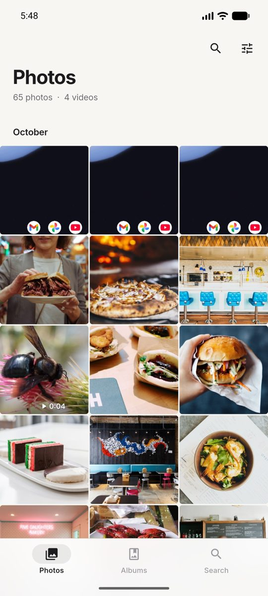
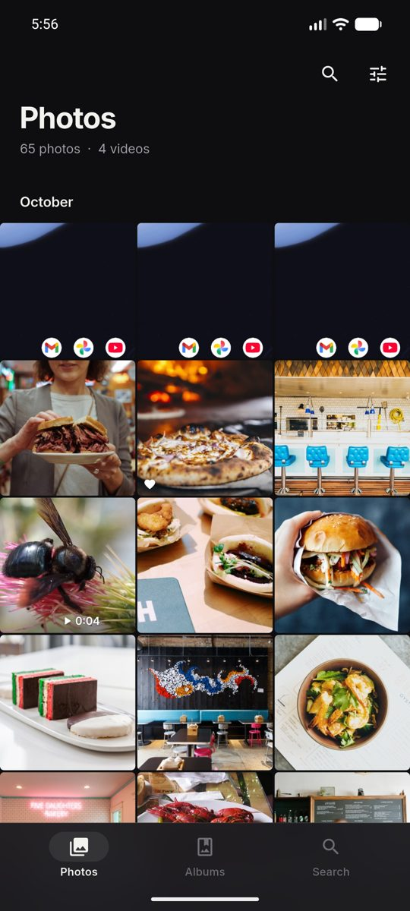
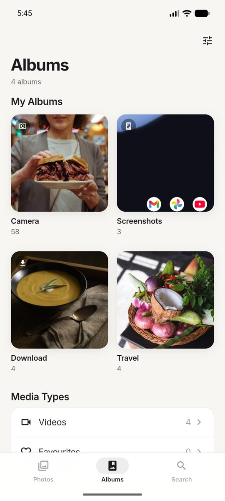
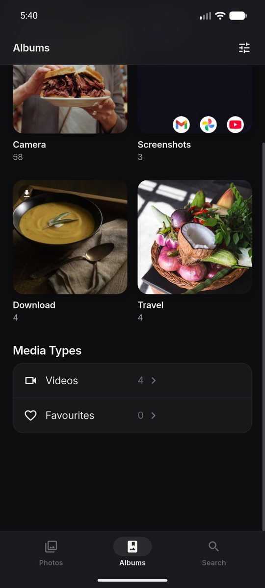

# Photos — a calm Flutter gallery

A minimalist, photography-first gallery for the photos and videos already on
the device. It reads the real system library through `photo_manager`; there
are no bundled or dummy images.

| Light | Dark |
| --- | --- |
|  |  |
|  |  |

More screenshots, all taken on the Android emulator, are in
[`docs/screenshots/`](docs/screenshots): onboarding, permission states,
limited access, viewer, info panel, selection, video, search and settings.

## Features

- **Photos**: an edge-to-edge adaptive grid (3 columns on phones, more on
  tablets) with a large title that collapses into a blurred pinned bar, a
  photo/video count, video badges with durations, favourite badges and
  optional grouping by day, month or year. Pages of 120 items load lazily and
  thumbnails are decoded at cell size, so libraries of thousands scroll
  smoothly.
- **Albums**: device albums as large cover cards. Camera, Screenshots and
  Downloads are pinned first and badged. A Media Types section lists Videos
  and Favourites. Every album opens as its own grid.
- **Viewer**: hero transition from the thumbnail, swipe between items, pinch
  and double-tap zoom, and tap to hide the chrome (immersive). Share,
  favourite, details and delete are in the toolbar. Video plays inline with a
  scrubber. The image loads in layers (grid thumbnail, then a screen-sized
  version, then a 2.5× detail version only once you zoom past 1.8×); the full
  original is never decoded.
- **Info panel**: date and time, file name, dimensions and megapixels, size,
  type, folder, and GPS location when recorded (tap to copy).
- **Search**: album names; dates ("2024", "march", "mar 2023", "today",
  "yesterday"); file names (Android only); filter chips for Photos, Videos,
  Screenshots and Favourites; Browse by Date year cards; recent searches with
  Clear. Search is metadata-only. There is no AI or content recognition.
- **Multi-select**: long-press to start, tap to toggle. The bar shows Cancel,
  the selected count and Select all, and a contextual bottom bar offers
  Share, Favourite and Delete.
- **First run and permissions**: a two-page welcome and explanation, then
  "Access My Photos". Handles full, limited and denied access. When access is
  permanently denied, it shows step-by-step Settings recovery. Limited access
  gets a banner and a "Select more photos" picker, and an empty library gets
  its own empty state. The app never shows a system prompt without explaining
  why first.
- **Settings** (all persisted): theme (System, Light, Dark), thumbnail size,
  grid density, date grouping, library counts, access level, a privacy note, a
  link to system permission settings, and the app version.
- **Reliability**: the library refreshes on app resume and on system media
  change notifications. Deleted or stale items drop out on refresh. Errors
  show a retry action. Text scaling is respected up to 1.6×.

## Design system

`lib/core/theme/` holds the design system:

- **Tokens** (`tokens.dart`): one spacing scale, radii, motion durations and
  curves, and icon sizes.
- **Colours** (`app_colors.dart`): semantic `AppColors` exposed as a
  `ThemeExtension`, with warm off-white or near-black surfaces, charcoal text
  and a single sparse blue accent. Light and dark are tuned separately.
- **Type**: bundled **Inter** (400/500/600/700, `assets/fonts/`, SIL OFL)
  with a tight, photography-app type scale.
- **Shared components** (`lib/shared/widgets/`): `Pressable` press feedback,
  buttons, sheets, skeletons, `LargeTitleScrollView`, grouped lists and the
  media grid.

## Project structure

```
lib/
  core/        theme, tokens, formatters, haptics
  services/    MediaService (the only code that talks to photo_manager),
               DeviceService (platform capabilities), PreferencesService
  shared/      providers, state (paging, selection, favourites),
               media actions, reusable widgets
  features/
    gallery/      home shell, Photos tab, collection view
    albums/       albums tab, album cards, collection screens
    viewer/       viewer, zoomable photo, video page, info sheet
    search/       search state, date parsing, search tab
    settings/     settings state and screen
    permissions/  access state, onboarding, denied and limited UI
```

State management is Riverpod 2.x. Every grid is driven by a value-type
`MediaQuerySpec` (album, type, favourites, date range, name), so the library,
albums, years, favourites and search results share one paginated loader. The
viewer reads the same loader instance as the grid it was opened from.

## Requirements

- Flutter 3.41 stable (Dart 3.11)
- Android SDK with platform 36, and Java 17
- iOS: Xcode 16 or later and CocoaPods (iOS 14+ deployment target)

## Setup and run

```bash
flutter pub get
```

```bash
flutter run
```

```bash
flutter build apk --debug
```

The debug APK is written to `build/app/outputs/flutter-apk/app-debug.apk`.

Other useful commands:

```bash
flutter analyze
```

```bash
flutter test
```

### Testing on an emulator with real media

An emulator usually has no photos. Push some and ask MediaStore to rescan:

```bash
adb push my-photos/. /sdcard/DCIM/Camera/
```

```bash
adb shell content call --method scan_volume --uri content://media --arg external_primary
```

Photos are dated by their EXIF `DateTimeOriginal` (MediaStore `datetaken`).
Files without it fall back to the time they were added to the device.

## Permissions

### Android (`android/app/src/main/AndroidManifest.xml`)

| Permission | Why |
| --- | --- |
| `READ_MEDIA_IMAGES`, `READ_MEDIA_VIDEO` | Read the library on Android 13+ |
| `READ_MEDIA_VISUAL_USER_SELECTED` | Android 14+ "Allow limited access" (selected photos) |
| `READ_EXTERNAL_STORAGE` (maxSdk 32) | Read the library on Android 12L and below |
| `WRITE_EXTERNAL_STORAGE` (maxSdk 29) | Delete media on Android 9 and below |
| `ACCESS_MEDIA_LOCATION` | Unredacted GPS for the info panel |

`requestLegacyExternalStorage` is set for Android 10.

### iOS (`ios/Runner/Info.plist`)

- `NSPhotoLibraryUsageDescription`: reading the library.
- `NSPhotoLibraryAddUsageDescription`: updating items, such as favourites.
- `PHPhotoLibraryPreventAutomaticLimitedAccessAlert`: the app offers its own
  "Select more photos" flow instead of the automatic system alert.
- The `Podfile` enables only `PERMISSION_PHOTOS` for `permission_handler`.

`permission_handler` is used only to detect "permanently denied" on Android.
All requests go through `photo_manager`.

## Platform behaviour and limitations

| | Android | iOS |
| --- | --- | --- |
| **Favourites** | Android 11+: the system MediaStore favourite flag, set through one `MediaStore.createFavoriteRequest` per action (a small channel in `MainActivity.kt`, so a multi-selection is one request). The system may show a confirmation. Android 10 and below: stored by the app (no system favourites exist). | PhotoKit favourites, shared with the Photos app. iOS may ask for permission to modify each item. |
| **Delete** | Android 11+: the system shows its own delete confirmation, after the app's. Deletion is permanent, not a trash. | Items go to *Recently Deleted* after the system confirmation. |
| **Limited access** | Android 14+ "selected photos". "Select more photos" opens the system picker. | iOS 14+ limited library. "Select more photos" opens the system picker. |
| **File-name search** | Supported (MediaStore `DISPLAY_NAME`). | Not available (PhotoKit can't query file names). Album and date search work. |
| **Location** | Needs `ACCESS_MEDIA_LOCATION`, which is requested with library access. | From `PHAsset.location`. |

Other limitations:

- Riverpod is pinned to 2.6 and `permission_handler` to 12.x. Newer majors
  need a newer Dart SDK or Android Gradle Plugin than Flutter 3.41 provides.
- Search by month without a year ("march") means the most recent March, not
  every March.
- Favouriting on Android 10 and below is app-local and doesn't sync with
  other apps.

## Verification status

Verified on the Android emulator (API 37, x86_64, 16 KB pages), debug build:

- onboarding, the permission prompt, a first denial, permanent denial with
  Settings recovery, limited access with the system picker, and full access;
- the gallery grid with grouping, Albums, album detail, Search (dates, chips,
  recents), the viewer (zoom, chrome toggle, info panel, favourite, delete
  confirmation), video playback, multi-select, and Settings;
- light and dark themes, including a live system theme switch;
- scrolling about 1,400 items with pagination;
- the native share sheet;
- a real delete through Android's system dialog, after which the viewer
  advanced and the counts updated;
- favouriting, which sets MediaStore `is_favorite`.

Not verified:

- **iOS**: no Mac was available, so it hasn't been built or run. The
  configuration is in place.
- Tablets and very large text sizes on a device.
- A multi-item favourite on Android, which goes through the batch
  favourite channel.
